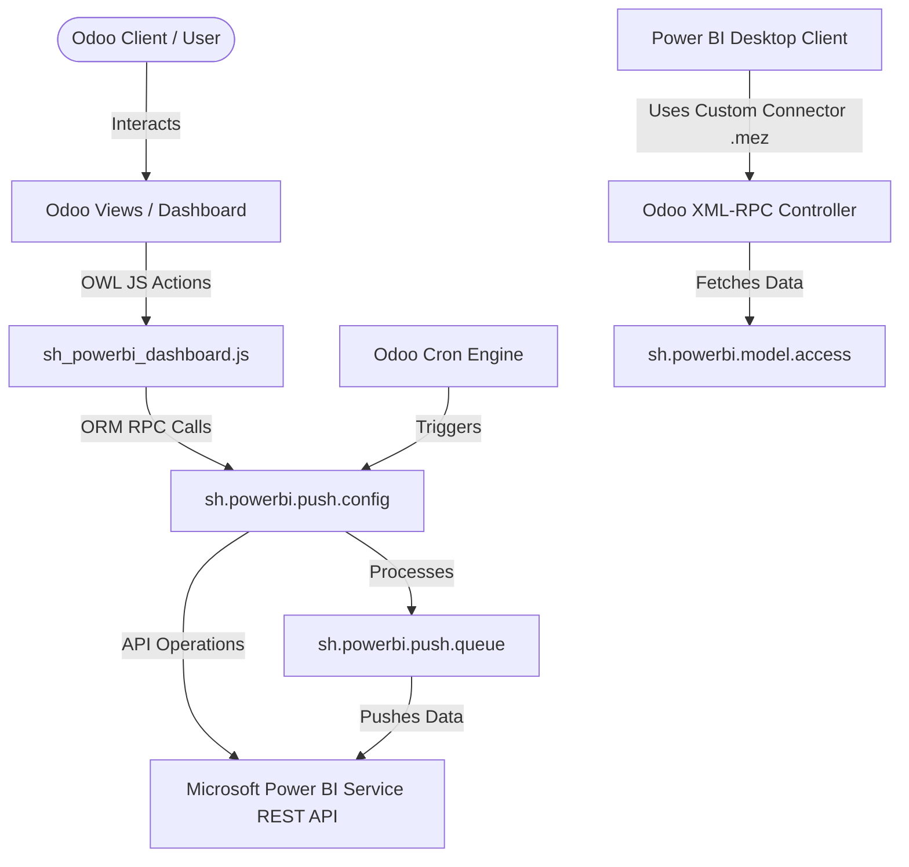

# Architecture — Power BI Odoo Connector
Status: [ACTIVE]
Backlink: [[00_overview]]

## System Structure
The integration follows a structured design separating configurations, data structures, background execution, and frontend controls:

## Layers and Communication

### 1. Presentation Layer (UI & OWL Components)
* Standard Odoo XML views define form/tree widgets for configuration screens.
* OWL JavaScript (`sh_powerbi_dashboard.js`) powers a visual dashboard displaying status metrics, charts for queue progress, connection health checks, and quick-action buttons.
* Calls `[[03_models]]` methods via Odoo ORM RPC mechanism.

### 2. Logic & Configuration Layer (Python Backend)
* Managed by core configuration models: `sh.powerbi.push.config` (for connection tokens/credentials) and `sh.powerbi.model.access` (for tables mapping).
* Interacts with Power BI endpoints to retrieve auth tokens, check schemas, and manage datasets.

### 3. Background Job Queue (Asynchronous Engine)
* Scheduled auto-push cron triggers record processing in batches.
* Work is delegated to a queue (`sh.powerbi.push.queue`), decoupling data changes from client requests.

### 4. Direct Pull Layer (Power Query custom connector)
* An XML-RPC interface allows Power BI Desktop clients to invoke pull-queries via Odoo's standard object APIs using the bundled `OdooConnectorBySofthealerTechnologiesV19.mez` custom connector.
