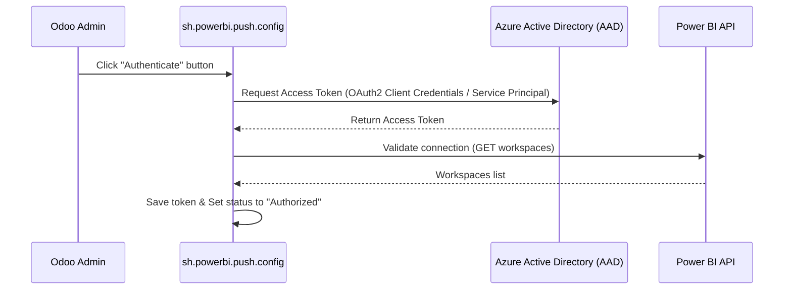

# Data Flow — Power BI Odoo Connector
Status: [ACTIVE]
Backlink: [[00_overview]]

## Major Data Flows

### Flow 1: Connection Authorization & Handshake

### Flow 2: Dataset Schema Generation & Push (Power BI REST API)
When a table configuration is synchronized or pushed:
1. **User Action:** Admin clicks **"Push Schema"** or **"Push Now"** on `[[03_models#sh.powerbi.model.access]]`.
2. **Schema Extraction:** `sh.powerbi.model.access` checks `allowed_field_ids`. If empty, it collects all stored non-binary fields of the Odoo model.
3. **Column-Limit Safeguard:** 
   - If the total columns exceed **75**, the system splits the columns into multiple sub-tables in Power BI, mapping them using the shared Odoo `id` field.
   - Splitting is **pair aware**: a Many2one field and its `<field>_display` companion are never separated into different part tables.
4. **API Call:** Odoo pushes the schema payload (tables & fields mapped to Power BI data types) to `/v1.0/myorg/groups/{workspace_id}/datasets`.
5. **Batch Push:** Odoo serializes matching database records (formatting dates as ISO 8601 strings and booleans as JSON booleans) and sends them to `/datasets/{dataset_id}/tables/{table_name}/rows`.

### Flow 2b: Relational Field Format
The relational values exported to Power BI depend on the **target company's** `sh_powerbi_relation_format`:

| Format | Many2one column | Companion column | One2many / Many2many |
|---|---|---|---|
| `id_and_display` (default) | numeric id (`Int64`) | `<field>_display` (`String`) | comma separated ids + companion |
| `id_only` | numeric id (`Int64`) | — | comma separated ids |
| `display_only` (legacy) | readable name (`String`) | — | comma separated names |

* The format is resolved from `model_access.company_id`, so a background push never inherits the executing user's company settings.
* The push dataset schema is **mode aware** — the foreign key column type follows the format, so `display_only` never pushes a name into an `Int64` column.
* Schema drift detection compares `table.column:dataType`, so a `String → Int64` change is detected and reported as a destructive "changed column types" diff.

### Flow 2c: Schema Drift Handling
1. `sh.powerbi.push.config._get_schema_diff` compares the Odoo schema (`table.column:dataType`) with the live Power BI dataset columns.
2. **Manual push** — a drift opens the [[03_models#sh.powerbi.schema.diff.wizard]] which splits the difference into **Added**, **Removed** and **Changed Column Types**.
3. **Background push (cron)** — a UI wizard cannot be presented, so the dataset is **recreated automatically** and the change is written to `sh.powerbi.log`. This prevents a silent stoppage of the scheduled sync.

### Flow 3: Real-Time / Event-Driven Sync
When `enable_realtime` is active on a Model Access configuration:
1. **Record Event:** A user creates or updates a record (e.g., `sale.order`).
2. **Hook Trigger:** Odoo's override intercept writes a job into `[[03_models#sh.powerbi.push.queue]]`.
3. **Deduplication:** Only one pending job per record/model is queued.
4. **Execution:** Cron or a manual dashboard trigger processes queue batches, calling Power BI POST APIs and updating logs in `[[03_models#sh.powerbi.log]]`.

### Flow 4: Direct Pull via Custom Connector (.mez)
1. **Desktop Actions:** In Power BI Desktop, user initiates "Get Data" using `OdooConnectorBySofthealerTechnologiesV19.mez`.
2. **Authentication:** User logs in with Odoo URL, DB name, and API Key generated in res.config.settings.
3. **RPC Queries:** Custom connector invokes standard Odoo XML-RPC endpoints to fetch schema dynamically and query model records, bypassing the 75-column push limit.

### Flow 5: Power BI REST Asset Discovery and Operations
1. Admin authorizes `sh.powerbi.push.config` with Azure service-principal credentials.
2. Odoo discovers Power BI workspaces through `/groups`, then datasets and reports through the selected workspace scope.
3. Dataset refresh and refresh-history actions use the cached dataset ID.
4. Report actions use cached report metadata for embed-token generation, rebind, and export-to-file job creation.
5. Export jobs are tracked in `sh.powerbi.export.job` and can be polled/downloaded when Microsoft marks them complete.

### Flow 6: Optional Fabric Discovery and Run Tracking
1. Admin creates `sh.powerbi.fabric.config` and authorizes against Microsoft Fabric using service-principal credentials.
2. Odoo discovers Fabric workspaces and items through Fabric REST APIs and caches them in `sh.powerbi.fabric.item`.
3. Admin can create supported Fabric item records through the Fabric item API where Microsoft supports creation.
4. Pipeline and Copy Job items can be started from Odoo. Run records are stored in `sh.powerbi.fabric.pipeline.run`.
5. Model Access records can use target mode `fabric_pipeline` to start the configured pipeline/copy job using the same domain and allowed-field configuration used by Power BI sync.
